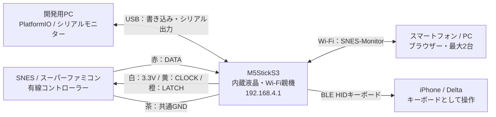
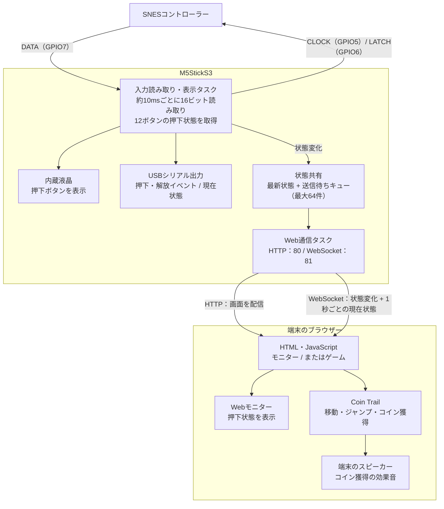

# SNES Controller Monitor for M5StickS3

有線SNES／スーパーファミコンコントローラーをM5StickS3に接続し、12ボタンの状態を内蔵液晶、USBシリアル、Webブラウザーに表示するファームウェアです。PlatformIOで開発・ビルドできます。

コントローラーの入力確認や、SNESのシリアル通信を使った電子工作の作例として利用できます。USB／BLE HIDキーボード出力で、Deltaなどのエミュレーター向けに入力を送信します。

## 動作映像

### Webモニター

[](https://x.com/ot_it_bridge/status/2106715352856203522)

実機コントローラーの操作を、M5StickS3の液晶とスマートフォンのWebモニターに表示している様子です。

[実機での動作映像を見る（X：@ot_it_bridge）](https://x.com/ot_it_bridge/status/2106715352856203522)

### BLE接続

BLE接続時の動作映像です。

[BLE接続の動作映像を見る（X：@ot_it_bridge）](https://x.com/ot_it_bridge/status/2109648035760550369?s=20)

## 機能

- 十字キー、A／B／X／Y、SELECT／START、L／Rの12ボタンを読み取り
- 実機のボタン配置に合わせた液晶表示。押したボタンを緑色で表示
- 同時押しに対応
- USB HIDキーボードとしてmGBAなどのエミュレーターを操作
- USB接続・サスペンドからの復帰時に、全キー解放と現在の押下状態を送信して入力を同期
- BLE HIDキーボード「SNES-Controller」として入力を送信。ペアリング情報の保存、切断後の接続待機、接続時の入力同期に対応
- 本体のBボタンを3秒長押ししてBLEペアリング情報を消去
- USBシリアルに押下・解放イベントと現在の押下状態を出力
- 約10ms間隔で入力を読み取り、状態が変わったときに表示を更新
- シリアルには状態変更時に加え、約2秒ごとに現在の状態を出力
- シリアルモニターを開かなくても液晶表示が動作
- M5StickS3がWi-Fi親機として動作し、最大2台の端末からWebモニターに接続
- WebSocketでボタンの変化を送信。接続時の状態同期、切断表示、自動再接続に対応
- ブラウザーで遊べる横スクロールゲーム「Coin Trail」。SNES操作で移動・ジャンプし、コイン取得時に効果音を再生

USB接続時はCDCシリアルとHIDキーボードの複合デバイスとして動作します。ゲームパッドではなくキーボード入力としてPCやiPhoneへ送信します。

### USB／BLE HIDキー割り当て

| SNES操作 | USB／BLEキーボード | mGBA既定操作 |
| --- | --- | --- |
| 十字キー | 矢印キー | 十字キー |
| B | Z | Game Boy B |
| A | X | Game Boy A |
| X | S | エミュレーター側で割り当て |
| Y | A | エミュレーター側で割り当て |
| L | Q | エミュレーター側で割り当て |
| R | W | エミュレーター側で割り当て |
| SELECT | Backspace | SELECT |
| START | Enter | START |

SNESのX／Y／L／Rは、使用するエミュレーターのキー設定でS／A／Q／Wに対応づけてください。Deltaでは「Settings → Controllers → Player 1」でキーボードを選択し、「Customize Controls」でSNESの各操作を割り当てます。USB／BLE HIDキーボードの同時押しは、それぞれ最大6キーです。

USB接続時やサスペンドからの復帰時には、最初に全キー解放を送信し、次の入力読み取りで現在の押下状態を送信します。押したまま接続した場合や、切断中にボタン状態が変わった場合も同期します。USB送信に失敗した場合は、次の読み取り時に最新状態で再試行します。

7キー以上を押した場合は、SNESのシリアル順で先頭の6キーを送信します。6キー以内に戻ると、引き続き押されているキーを最新状態から反映します。

ブラウザー上のnoVNCで使用する場合は、接続したゲーム画面をクリックしてキーボードフォーカスを与えてください。

### iPhone・DeltaへのBLE接続

1. M5StickS3の電源を入れます。液晶上部の`BLE: SNES-Controller`は接続待機中を示します。
2. iPhoneの「設定 → Bluetooth」で **`SNES-Controller`** を選択してペアリングします。PIN入力のないJust Works方式で、暗号化とボンディングを行います。
3. 液晶に`BLE: connected`と表示されたら、Deltaの「Settings → Controllers → Player 1」でキーボードを選択します。
4. 「Customize Controls」でSNESを選び、上のキー割り当てに対応づけます。

BLE接続ではiPhoneのUSB-C／Lightning端子を使いません。M5StickS3はバッテリーでも動作します。**iPhone 12 ProとiPhone 17でBLE接続・Deltaでの操作を実機確認済み**です（2026年10月12日、利用者による確認）。ペアリングとBluetoothのOFF→ON後の再接続も確認済みです。

切断すると再び接続待機に戻り、ペアリング済み端末からの再接続を受け付けます。入力送信は暗号化とホストによる通知購読が完了してから開始します。接続・復帰時は全キー解放を送り、次の入力読み取りで現在の状態を送ります。液晶の`BLE: waiting for host`は、接続後に暗号化・通知購読・HID復帰を待っている状態です。

端末を変更する場合や再ペアリングが必要な場合は、**M5StickS3本体のBボタンを3秒長押し**します。SNESコントローラーのBボタンとは異なります。接続中のBLE端末を切断して保存済みペアリング情報をすべて消去するので、iPhone側でも`SNES-Controller`を「このデバイスの登録を解除」してから接続し直してください。

通常ビルドではUSBとBLEの両方に入力を送ります。同じ端末へ両方を接続した場合の重複入力を避けるため、Deltaでの検証時は片方を接続してください。

## 必要なもの

- M5StickS3
- 有線SNES／スーパーファミコンコントローラー（CLOCK・LATCH・DATA方式）
- 配線材、必要に応じてコントローラー用の延長ケーブルや変換コネクタ
- データ通信対応のUSBケーブル
- PlatformIOの開発環境（VS Code + PlatformIO IDE、またはPlatformIO Core）

USB接続の互換コントローラーや、スーパーファミコンミニ用コントローラーは、この配線・通信方式の対象ではありません。

## 機器構成図

M5StickS3に有線コントローラーを接続し、スマートフォンやPCはM5StickS3のWi-Fiに直接接続します。無線ルーターやインターネット接続は不要です。



USBはファームウェアの書き込みとシリアルモニターの利用に必要です。液晶・Web表示・ゲームの利用時は、本体のバッテリーでも動作します。線色は以下の配線表と同じ作例のものです。

## 配線（3.3V給電）

M5StickS3上部のHat2-Busを使用します。電源を切った状態で、本体の端子表記を確認して配線してください。

| コントローラーの線色（一般的な配色） | 信号 | M5StickS3の接続先 | 信号の方向 |
| --- | --- | --- | --- |
| 白 | VCC | **3V3_L2** | M5StickS3 → コントローラー |
| 茶 | GND | **GND** | 共通グランド |
| 黄 | CLOCK | **G5（GPIO5）** | M5StickS3 → コントローラー |
| 橙 | LATCH | **G6（GPIO6）** | M5StickS3 → コントローラー |
| 赤 | DATA | **G7（GPIO7）** | コントローラー → M5StickS3 |

GPIO番号はコネクタの物理的なピン番号とは異なります。互換品や交換ケーブルでは線色が異なる場合があるため、色だけで判断せず、コネクタや基板との導通を確認してください。

### 電源・信号電圧

SNESコントローラーの本来の電源は5Vです。このプロジェクトでは3.3Vで給電しますが、すべての純正品・互換品での動作を保証するものではありません。ファームウェアは初期化時に3.3V LDO出力を有効にします。

**M5StickS3のGPIOに5V信号を直接入力しないでください。** コントローラーを5Vで動作させる場合は、CLOCK／LATCHを3.3V→5V、DATAを5V→3.3Vへ変換する適切なレベル変換回路が必要です。白線だけを5V端子へ変更して、DATAをGPIOへ直結する配線は避けてください。

## 処理ブロック図

入力読み取り・液晶表示と、Web通信は別のタスクで処理します。ゲームの描画・進行・効果音はアクセスした端末のブラウザーで実行します。



各端末はモニターまたはゲームのどちらかを開き、合計2画面まで接続できます。ゲームの進行とコイン数は端末ごとに独立しています。

## ビルド・書き込み

M5StickS3をUSB接続し、PlatformIOでプロジェクトのルートフォルダーから実行します。シリアルモニターは**115200bps**です。

```bash
pio run
pio run -t upload
pio device monitor -b 115200
```

既定の`m5stack-sticks3`はUSB・BLE・Wi-Fi Webモニターを有効にします。Wi-Fiとの無線競合や消費電力を比較する場合は、USB・BLEを有効にしてWi-Fiを起動しない`m5stack-sticks3-ble`を使用します。

```bash
pio run -e m5stack-sticks3-ble
pio run -e m5stack-sticks3-ble -t upload
```

BLEは現在のArduino core 2.0.17に含まれるBLEライブラリを使用し、外部のBLEライブラリは追加していません。接続間隔は15〜30msを要求しますが、実際の間隔はホストが決定します。入力の読み取り間隔や接続間隔は、Deltaでの応答時間そのものではありません。遅延比較は同じ端末・ゲームでBLE専用とWi-Fi併用を測定してください。

Arduino coreのログレベルは`CORE_DEBUG_LEVEL=3`（INFO）に設定しています。レベル5（VERBOSE）ではiPhoneのペアリング確定直後に再起動する現象が再現し、レベル3では認証成功・接続維持・BluetoothのOFF→ON後の再接続・Deltaでの操作を確認しました（2026年10月12日）。詳細ログの処理負荷が原因候補ですが、クラッシュ内部の原因は未特定です。

USBシリアルには、再起動理由・空きヒープ・BLEの状態を示す`DIAG`と、BLEイベント・認証結果・Bluetoothタスクのスタック残量を示す`BLE diag`を出力します。最後のBLE診断はRTC RAMに保持し、ソフトウェア再起動後に`BLE previous boot`として出力します。調査の記録にNVSへの追加書き込みは行いません。

ブラウザーゲームの入力処理は、Node.js環境で次の回帰テストを実行できます。USB EnterとWi-Fi STARTの到着順、長押し、キーボードのみの操作などを確認します。

```bash
node tests/game-input.test.mjs
```

USBキーボードの接続時同期・送信失敗時の再試行は、C++11対応コンパイラーで次の回帰テストを実行できます。

```bash
c++ -std=c++11 -Wall -Wextra -Werror tests/usb-keyboard-state.test.cpp -o /tmp/snes-usb-keyboard-test
/tmp/snes-usb-keyboard-test
```

BLEの暗号化・通知購読・再接続・HIDサスペンド・プロトコル切替による送信可否を、共通のキーボード状態同期と組み合わせて検証できます。

```bash
c++ -std=c++11 -Wall -Wextra -Werror tests/ble-keyboard-link.test.cpp -o /tmp/snes-ble-keyboard-test
/tmp/snes-ble-keyboard-test
```

## 液晶表示

横向きの画面に、コントローラーの形とボタンを表示します。

```text
        L                              R

        ↑                              X
     ←  ＋  →     SELECT  START      Y     A
        ↓                              B
```

押していないボタンは灰色、押しているボタンは緑色になります。上部にBLEの接続状態とWi-Fi名・アクセス先、下部に`NO BUTTON PRESSED`または`GREEN = PRESSED`を表示します。BLE専用ビルドではWi-Fi欄に`Wi-Fi OFF / BLE only`を表示します。Wi-Fiの初期化に失敗した場合も液晶とシリアルの表示は継続します。

## Webモニター

1. スマートフォンやPCをWi-Fi **`SNES-Monitor`** に接続します。パスワードは **`12345678`** です。
2. ブラウザーで **`http://192.168.4.1/`** を開きます。
3. 「接続済み」と表示されたら、コントローラーを操作します。液晶と同じボタン配置で押下状態を表示します。

Wi-Fiの同時接続は最大2台、WebSocket接続も最大2画面です。各端末で1画面ずつ開いてください。画面上のボタンは表示専用です。

インターネット接続は不要です。端末に「インターネット接続なし」と表示されても、このWi-Fiへの接続を維持してください。HTTPSではなくHTTPでアクセスします。

切断時は押下表示を消して状態不明と表示し、自動再接続します。再接続時には全ボタンの現在状態を同期します。状態変更時の送信に加え、1秒ごとに現在状態を送信し、約5秒間受信できない場合は再接続を試みます。

入力読み取りと液晶表示は通信処理とは別のタスクで実行します。通信が滞った場合に送信待ちが無制限に増えないよう、保留状態は最大64件とし、上限に達すると古いものから破棄します。通信混雑時の短い操作はWeb側で取りこぼす場合があります。

## 横スクロールゲーム「Coin Trail」

同じWi-Fiに接続し、**`http://192.168.4.1/game`** を開きます。モニター画面の「横スクロールゲームで遊ぶ」からも移動できます。

最初に画面の **「プレイ・音を有効にする」** を押してください。コインを取ると、アクセスしている端末のスピーカーから効果音が鳴ります。音は画面のボタンでOFFにできます。

| SNES操作 | 動作 |
| --- | --- |
| 十字キー左右 | 左右移動 |
| B / A | ジャンプ。短く押すと低く、長く押すと高く跳ぶ |
| Y + 左右 | ダッシュ |
| START | 一時停止 / 再開 |
| SELECT | コイン数とコースをリセット |

足場を跳び渡り、コインを集めるゲームです。モンスターとゴール旗はありません。穴に落ちると近くの地面から復帰し、集めたコインは維持します。コースの端まで進むと次の周回になり、コインが再配置されます。キャラクター、背景、効果音はコードで生成し、画像・音声ファイルや外部配信サービスは使用しません。

PCでは矢印キー、Space / Z（ジャンプ）、Shift（ダッシュ）、Enter（一時停止 / 再開）でも操作できます。タブが非表示になると一時停止します。Wi-Fi切断時はSNES入力を解除し、再接続を試みます。

各端末のゲーム進行とコイン数は独立しています。同じSNESコントローラーの入力が両方に届きます。モニターとゲームはそれぞれ1つのWebSocket接続を使うため、合計2画面までにしてください。ゲームの状態はページを閉じると失われます。

## シリアル出力

出力例です。時刻は起動後の経過時間（ミリ秒）です。

```text
[1000 ms] B PRESSED
[1000 ms] STATE: B (mask=0x001)
[1200 ms] A PRESSED
[1200 ms] STATE: B A (mask=0x101)
[1500 ms] B RELEASED
[1500 ms] STATE: A (mask=0x100)
[1700 ms] A RELEASED
[1700 ms] STATE: NONE (mask=0x000)
```

`mask`は押下状態を表す12ビットの値です。下位ビットから順に、B、Y、SELECT、START、UP、DOWN、LEFT、RIGHT、A、X、L、Rが対応し、`1`が押下を表します。

## プロジェクト構成

| ファイル | 内容 |
| --- | --- |
| `src/main.cpp` | コントローラー読み取り、液晶描画、USB／BLE更新、シリアル出力 |
| `src/keyboard_state.h` | USB／BLE共通のキー割り当て、接続時の状態同期、送信失敗時の再試行 |
| `src/ble_keyboard.cpp` / `src/ble_keyboard.h` | BLE HIDサービス、暗号化・ボンディング、接続待機、ペアリング情報の消去 |
| `src/ble_keyboard_link.h` | BLEの暗号化・通知購読・HIDプロトコルによる送信可否の管理 |
| `src/web_monitor.cpp` / `src/web_monitor.h` | Wi-Fi親機、HTTP配信、WebSocketによる状態送信 |
| `src/web_page.h` | 外部通信不要のWebモニター画面 |
| `src/game_page.h` | 横スクロールゲーム、操作処理、コイン効果音 |
| `platformio.ini` | ボード、Arduinoフレームワーク、依存ライブラリの設定 |
| `.gitignore` | ビルド生成物などのGit管理対象からの除外 |
| `LICENSE` | 本プロジェクトのMIT License |

GPIOを変更する場合は、`src/main.cpp`の`kClockPin`、`kLatchPin`、`kDataPin`を変更してください。

Wi-Fi名とパスワードは`src/web_monitor.h`で設定できます。

直接指定する依存ライブラリは、動作確認済みの以下のバージョンに固定しています。

| ライブラリ | 固定先 |
| --- | --- |
| M5Unified | `fd40d58b8405ad1e7ed7afab548dab5e7cec5bbb` |
| M5PM1 | `be9a5456c007c333e7ac963f33bfde1ffa5d82ee` |
| WebSockets | `2.7.2` |

M5UnifiedとM5PM1はGitHubから指定コミットを取得します。これらが間接的に取得する依存ライブラリのすべてを固定する構成ではありません。

## ライセンス

本プロジェクトのソースコードおよび付属ドキュメントは[MIT License](LICENSE)で公開します。著作権表示は `Copyright (c) 2026 otitbridge` です。

改変・再配布・商用利用を認め、本プロジェクトを利用した機器の製作・販売を含む商用利用を歓迎します。再配布するコードやドキュメントには著作権表示とライセンス文を保持してください。MIT Licenseは改変コードの公開を義務付けません。

依存ライブラリには、それぞれのライセンスが適用されます。本プロジェクトのMIT Licenseによって変更されるものではありません。

| 直接指定する依存ライブラリ | ライセンス |
| --- | --- |
| M5Unified | [MIT](https://github.com/m5stack/M5Unified/blob/fd40d58b8405ad1e7ed7afab548dab5e7cec5bbb/LICENSE) |
| M5PM1 | [MIT](https://github.com/m5stack/M5PM1/blob/be9a5456c007c333e7ac963f33bfde1ffa5d82ee/LICENSE) |
| WebSockets | [LGPL-2.1](https://github.com/Links2004/arduinoWebSockets/blob/2.7.2/LICENSE) |

依存ライブラリを含むファームウェアや製品を配布する場合は、間接依存を含め各ライブラリのライセンス条件にも従ってください。M5StickS3やSNESコントローラーなど既存製品の設計・商標は、本プロジェクトのライセンス対象ではありません。

## 動作確認状況・制限

- M5StickS3向けのPlatformIOビルドと、USB経由の書き込みを確認済み
- iPhone 17（USB-C）・iOS 26.6.2・Delta 1.7.3sで、USB接続したM5StickS3がDeltaに外付けキーボードとして認識されることを実機確認済み（2026年10月12日、利用者による確認）
- USB切断・再接続とサスペンドからの復帰時の入力同期は、iPhone・Deltaでの実機確認が必要
- iPhone 12 Pro・iPhone 17でBLE接続とDeltaでの操作を実機確認済み（2026年10月12日、利用者による確認）。BLEペアリング・認証成功・接続維持、BluetoothのOFF→ON後の再接続も利用者確認とUSBログで確認済み
- BLE接続での全ボタンの網羅的な操作、ペアリング情報消去、実際の遅延は実機確認が必要
- 開発時の3.3V配線で、初期の入力表示について動作確認の報告あり
- 使用コントローラーの型番や、複数モデルでの互換性確認は未記録
- Webモニターの2台同時接続、実際の応答時間は実機での確認が必要
- 未接続と「どのボタンも押されていない状態」は区別しません。未接続時にも`NONE`と表示される場合があります

## 参考資料

- [M5Stack公式：StickS3仕様・ピンマップ](https://docs.m5stack.com/en/core/StickS3)
- [raphnet：SNESコントローラーの配線色（8ページ）](https://www.raphnet-tech.com/downloads/M_NSDB9_PCB_ENG3.pdf)
- [Espressif：ESP32-S3データシート](https://www.espressif.com/sites/default/files/documentation/esp32-s3_datasheet_en.pdf)
- [M5Unified](https://github.com/m5stack/M5Unified)
- [M5PM1](https://github.com/m5stack/M5PM1)
- [arduinoWebSockets](https://github.com/Links2004/arduinoWebSockets)
